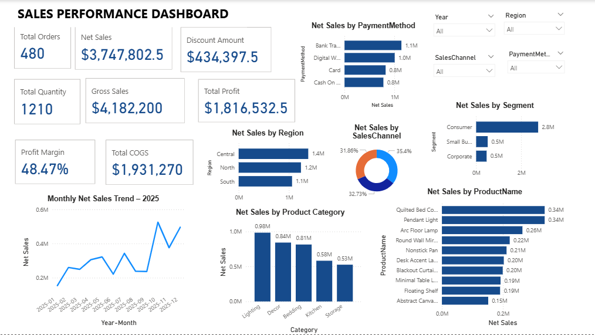

# Sales Performance Dashboard | Power BI

## Project Overview
This project focuses on analyzing sales performance using an interactive dashboard developed in Microsoft Power BI. The dashboard transforms sales data into meaningful business insights to support data-driven decision-making.

## Project Objectives
- Monitor overall sales, revenue and profitability.
- Analyze monthly sales trends.
- Identify top-performing products and product categories.
- Compare sales performance across different sales channels and payment methods.
- Explore customer segments and regional performance.

## Tools & Technologies
- Microsoft Power BI
- Power Query
- DAX (Data Analysis Expressions)

## Dashboard Preview

## Key Features
- KPI cards for orders, quantity, gross sales, net sales, discounts, cost and profit.
- Monthly net sales trend analysis.
- Sales analysis by product category.
- Top 10 products by net sales.
- Sales channel and payment method analysis.
- Customer segment and regional analysis.
- Interactive slicers for filtering dashboard results.

## Skills Demonstrated
- Data cleaning and transformation
- Data modeling
- DAX measures and calculations
- Business intelligence reporting
- Data visualization
- Interactive dashboard development

## Key Learning Outcomes
Through this project, I gained practical experience in transforming raw sales data into an interactive business intelligence dashboard and presenting information in a way that supports business analysis.

## Project Files
- `Sales Performance Dashboard.pbix` – Power BI project file.
- `Dashboard-Screenshot.png` – Dashboard preview.

## Project Status
Completed — Beginner-level Business Intelligence portfolio project.
